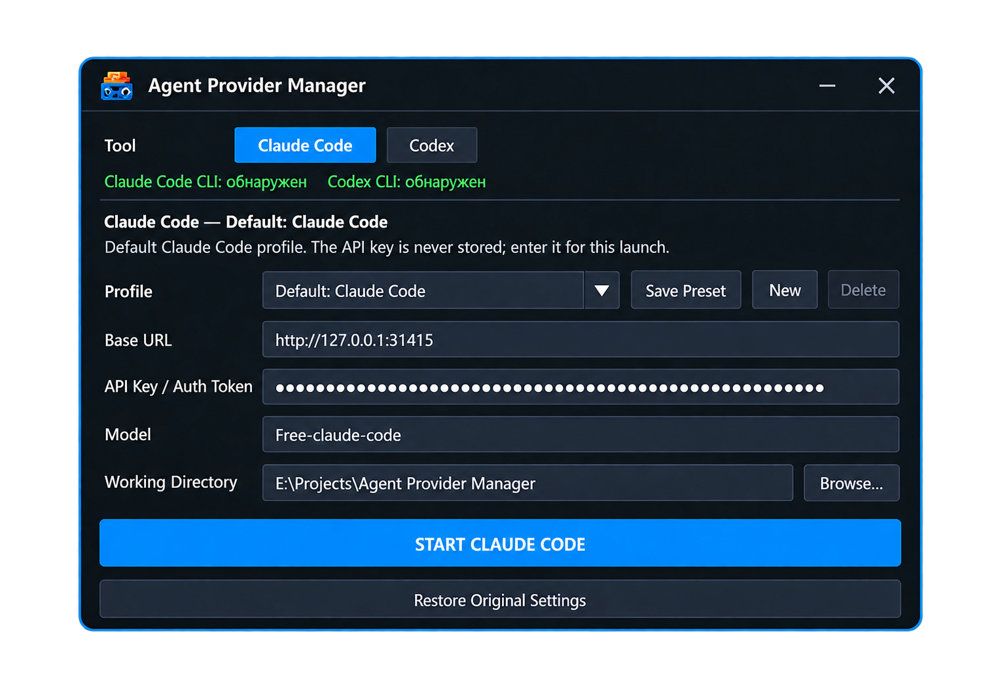

# Agent Provider Manager

A lightweight Windows launcher for **Claude Code** and **OpenAI Codex**.
Set the provider URL, API key, model, and working directory, then launch
the selected CLI in its own interactive console.



## Download and run

1.  Open **[Releases](../../releases)**.
2.  Download the latest `AgentProviderManager-*.zip`.
3.  Extract the ZIP.
4.  Run `ClaudeProviderLauncher.exe`.

The release is self-contained for Windows x64; .NET does not need to be
installed separately.

## Requirements

-   Windows x64
-   Claude Code CLI (`claude` in `PATH`) for Claude Code
-   OpenAI Codex CLI (`codex` in `PATH`) for Codex

## Use

1.  Select **Claude Code** or **Codex**.
2.  Enter the **Base URL**, **API Key / Auth Token**, and **Model**.
3.  Choose an existing **Working Directory**.
4.  Click **START CLAUDE CODE** or **START CODEX**.

The selected tool opens in a separate interactive console window.

## Presets and privacy

-   Save, overwrite, and delete named presets for each tool.
-   A preset stores the Base URL, key/token, and model. The working
    directory is selected separately.
-   Recent values remember the Base URL, model, and working directory;
    the API key is not stored there.
-   Preset keys are encrypted with Windows DPAPI for the current Windows
    user.
-   The launcher does not modify global Windows environment variables or
    your existing Claude Code and Codex configuration files.

## Build from source

Install the [.NET 10
SDK](https://dotnet.microsoft.com/download/dotnet/10.0), then run:

``` powershell
dotnet publish "src\ClaudeProviderLauncher\ClaudeProviderLauncher.csproj" -c Release -r win-x64 --self-contained true -p:PublishSingleFile=true -p:DebugType=none -p:DebugSymbols=false -o "dist\AgentProviderLauncher"
```

Run tests:

``` powershell
dotnet test "tests\ClaudeProviderLauncher.Tests\ClaudeProviderLauncher.Tests.csproj" -c Release
```
